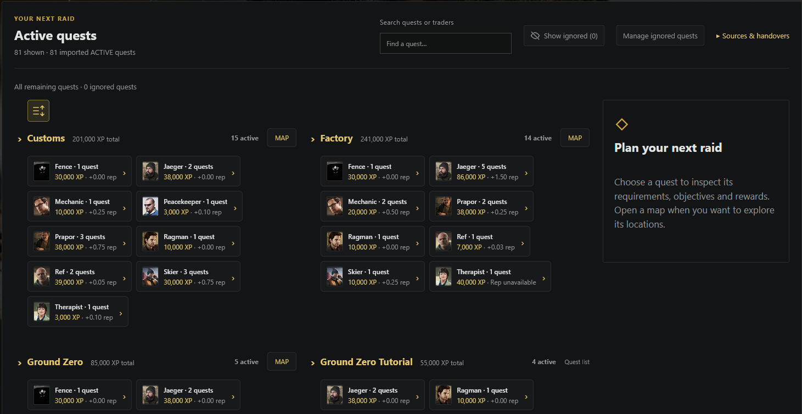
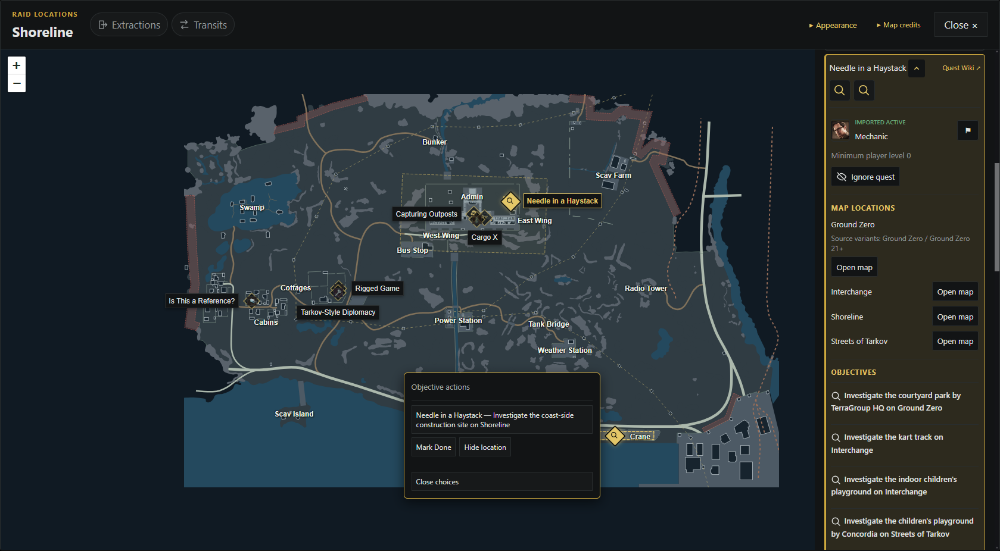
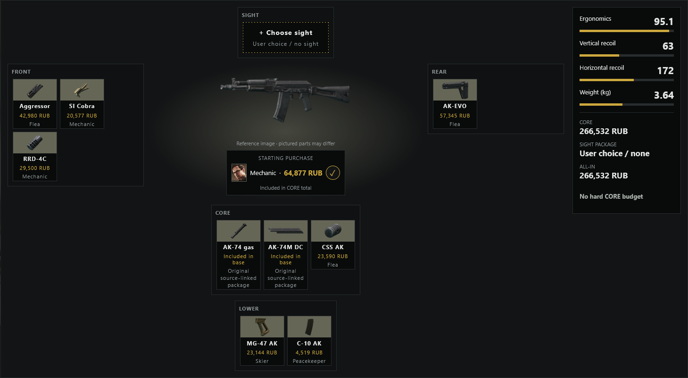

# Tarkov Hervolario · Planning edition

A Windows companion for planning your next Escape from Tarkov raid. Pick quests to do together, locate objectives on the map, and price builds using the traders and flea market available to your character.

[Visit the app showcase](https://isma373.github.io/TarkovHervolario-Planning/)

**[Download RC5 for Windows x64](https://github.com/isma373/TarkovHervolario-Planning/releases/download/planning/v2026.11.0rc5/TarkovHervolario-Planning-2026.11.0rc5-windows-x64.zip)** · [Release notes and package manifest](https://github.com/isma373/TarkovHervolario-Planning/releases/tag/planning/v2026.11.0rc5)

## Getting started

Extract the whole portable ZIP and run `TarkovHervolario-Planning.exe`. First setup downloads public catalogues. The only Tarkov folder you need to link is **Logs**. The app runs outside the game and checks the linked logs read-only at startup for active and completed quests and supported PMC level updates. You can refresh after a raid while the app is open.

## Active Quests

Compare tasks, traders and XP by map to decide which objectives to take into one raid.

## Raid maps

Select a quest marker to see its objectives. This Shoreline example shows the coast-side construction site for *Needle in a Haystack*.

## Weapon Planner

Compare parts against your PMC level, trader access and loyalty. Flea estimates use the latest available 24-hour average for your PvP mode. When progression changes a purchase option, the planner rechecks affected saved builds and presents any changes for review.

## Between raids

- Check [your character dashboard](docs/assets/dashboard.webp) and keep [Regular and Seasonal characters separate](docs/assets/modes.webp).
- [Browse quest rewards](docs/assets/reward-search.webp) and [trace a reward path](docs/assets/quest-path.webp) before adding it to your plan.
- Set [Hideout targets](docs/assets/hideout.webp) and see [which items your quests and upgrades require](docs/assets/requirements.webp).

For future versions, close the app and extract the new ZIP to a fresh folder. Your character profile is stored separately. [All releases](https://github.com/isma373/TarkovHervolario-Planning/releases)

## License

Tarkov Hervolario by isma373 is free to use. You may share the complete, unmodified official release free of charge with credit and all license notices. [Read the freeware license](LICENSE.txt).
